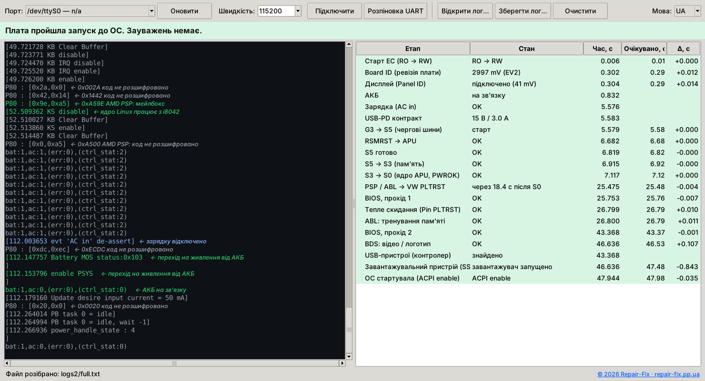
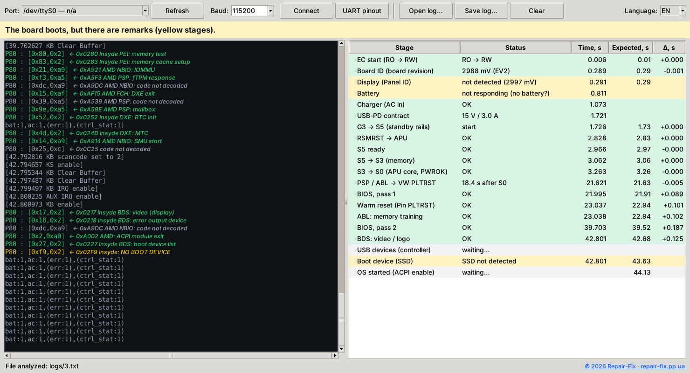
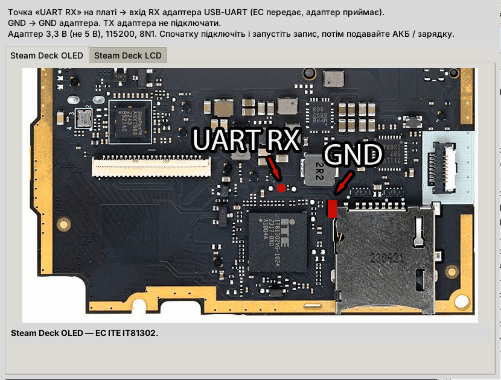

<div align="center">

# Repair-Fix UART Analyzer

**EC UART log analyzer for Steam Deck OLED: power sequence, BIOS POST codes, hang diagnostics**

[](#download)
[](#run-from-source)
[](#limitations)
[](LICENSE)

[Українська](README.md) · **English** · [Русский](README.ru.md)



</div>

## What it is

A tool for repair technicians. Hook a USB-UART adapter to the EC of a Steam Deck OLED board, apply power, and watch in real time where the board is in its start-up: power sequencer, PSP and memory training, BIOS, SteamOS boot. Every log line is decoded, stages are colour-coded, and if the board hangs you get a hint at the bottom: which step it stopped at and what the EC is probably waiting for.

## Features

- COM port and baud selection, live reading or opening a saved `.txt` (you can drop a file onto the `.exe`).
- EC power sequence decoding: G3 → S5 → S3 → S0, `P_Seq` steps, RSMRST, PLTRST.
- POST code decoding: Insyde H2O (`0x02XX`) and AMD AGESA (`0xE0XX` ABL / memory, `0xA5XX` PSP, `0xA9XX` NBIO, `0xAFXX` FCH).
- 20 start-up stages with time, expected time (from G3 → S5) and deviation Δ.
- Hang detection: sequencer stalled, board stuck in S5/S3, no PLTRST after S0, BIOS stuck on one code, memory training error, EC reboot.
- "UART pinout" window with photos of the connection points for OLED and LCD.
- Log saving; interface in Ukrainian, Russian and English.

## Colours

| Colour | Meaning |
|---|---|
| 🟢 Green | Stage passed, event is normal |
| 🟡 Yellow | Something not connected or not seen: battery, display, SSD, controller board, weak charger, timing deviation |
| 🔴 Red | Error or hang |
| ⚪ Grey | Line without decoding (code not in any known table) |



## UART pinout

| Board point | Connect to |
|---|---|
| **UART RX** | adapter RX (EC transmits, adapter receives) |
| **GND** | adapter GND |
| adapter TX | leave unconnected |

Use a **3.3 V** adapter (not 5 V), **115200, 8N1**. Connect UART and start capturing first, then apply battery or charger.



## Download

A ready `RepairFix_UART_Analyzer.exe` is in [Releases](../../releases). No installation: download and run.

## Run from source

```bash
pip install -r requirements.txt
python deck_uart_analyzer.py                                   # with a COM port
python deck_uart_analyzer.py samples/03_bare_board_no_ssd.txt  # open a log right away
```

Requires Python 3.8+ with tkinter (included in the standard python.org installer).

## Building the .exe

Put your own `icon.ico` next to the script (optional) and run:

```bat
build_exe.bat
```

Output: `dist\RepairFix_UART_Analyzer.exe`. The script closes a running copy, cleans the previous build and refreshes the Windows icon cache.

GitHub Actions builds the `.exe` too: on every push it appears under the run's artifacts, and on a `v*` tag (e.g. `v1.4.2`) it is attached to a new release.

> If Explorer still shows the old `.exe` icon after a rebuild, that is the Windows icon cache. Rename the file or restart Explorer.

## Usage

1. Connect the adapter as shown above.
2. Pick the port, 115200, press **Connect**.
3. Power the board (battery and/or charger).
4. Watch the stages on the right and the verdict on top. For the next board press **Clear**.
5. **Save log…** writes the raw log to `.txt`.

## Documentation

[`docs/power-sequence`](docs/power-sequence) holds a breakdown of the Steam Deck OLED start-up:

- power sequence tables with exact log records and decoded POST codes (`.xlsx`, UA and RU);
- sequencer timing diagram and overall start-up timeline (`.png`);
- HTML page with the diagrams, EC pins, BIOS stages and rail measurements.

## Sample logs

| File | What is connected |
|---|---|
| [`01_no_battery_no_controllers.txt`](samples/01_no_battery_no_controllers.txt) | No battery, no controller board |
| [`02_no_display_with_ssd_cut.txt`](samples/02_no_display_with_ssd_cut.txt) | No display, with SSD (start not captured) |
| [`03_bare_board_no_ssd.txt`](samples/03_bare_board_no_ssd.txt) | Bare board, no SSD |
| [`04_battery_ssd_display.txt`](samples/04_battery_ssd_display.txt) | Battery, SSD, display |
| [`05_full_assembly_cut.txt`](samples/05_full_assembly_cut.txt) | Full assembly (start not captured) |
| [`06_full_assembly_battery_then_charger.txt`](samples/06_full_assembly_battery_then_charger.txt) | Full assembly: UART → battery → charger → charger unplugged |

All logs come from a working DA0F7GMBAE0 rev E board, EC G01090. `python tests/check_samples.py` runs the analyzer over all of them.

## Limitations

- Tuned for **Steam Deck OLED** (EC ITE IT81302). On LCD (EC IT5570) the log may differ.
- Signals named in `P_Seq` hints are **assumptions** based on a Chromebook IT8320 reference and are marked "assumed". Exact mapping needs a scope.
- AMD codes come from AGESA tables of server boards (Gigabyte MJ11-EC0, MZ01-CEx). Some numbers may differ on the Van Gogh APU.
- Codes found in no table are shown grey without decoding.

## Author

**Repair-Fix** — game console and electronics repair.
Website: [repair-fix.pp.ua](https://repair-fix.pp.ua)

Found a mismatch or have a log from another board or console? Open an [Issue](../../issues).

## License

The program is free.

- **Code** — [GNU GPL v3](LICENSE). Free to use, including for commercial repair work, to modify and to redistribute. Modified versions must ship with source code under the same license and keep the copyright notice.
- **Documentation, diagrams, tables and sample logs** (`docs/`, `samples/`) — [CC BY 4.0](docs/LICENSE.txt). Republish anywhere with a link to [repair-fix.pp.ua](https://repair-fix.pp.ua).
- The **Repair-Fix** name and logo are not covered by the license: publish modified versions under a different name.

© 2026 Repair-Fix
