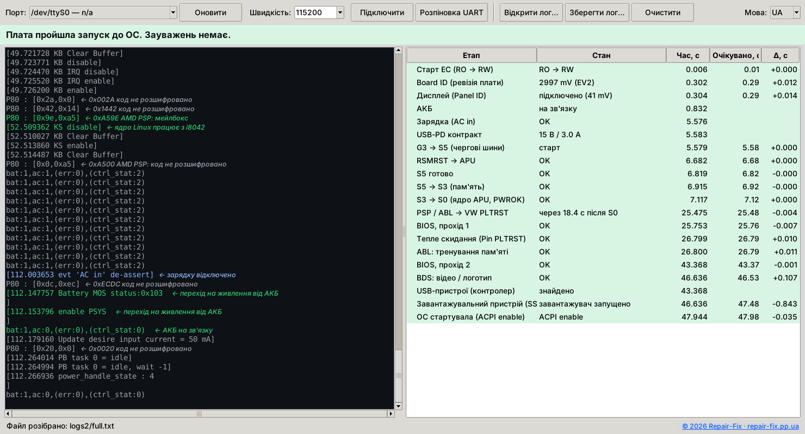
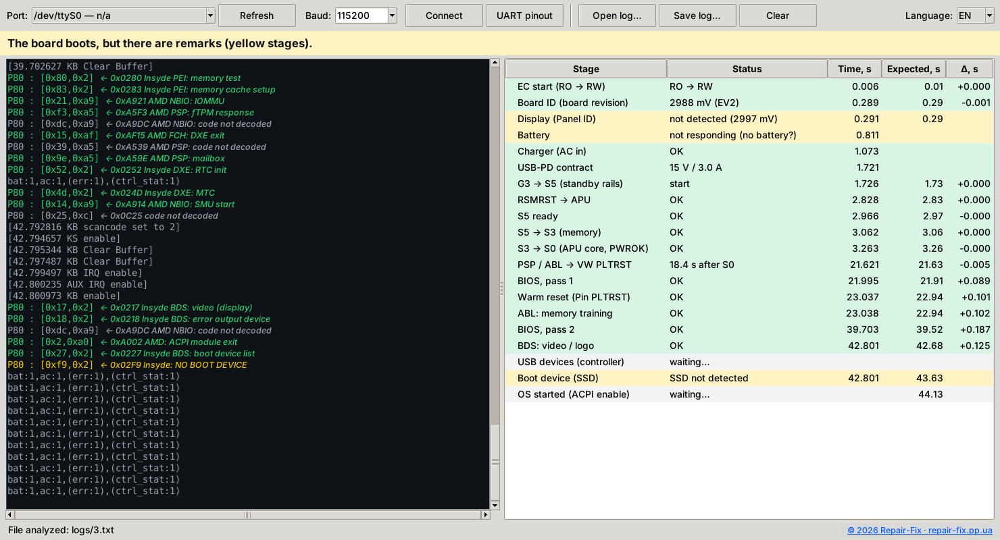
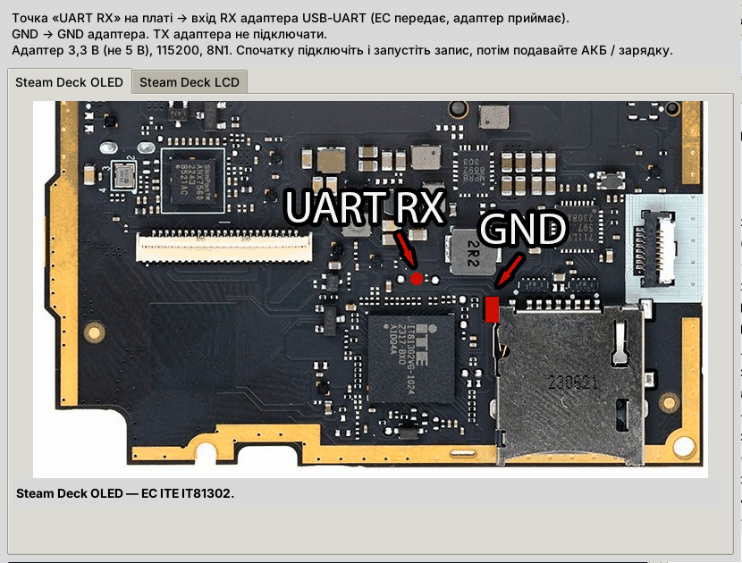

<div align="center">

# Repair-Fix UART Analyzer

**Аналізатор UART-логу EC для Steam Deck OLED: power sequence, POST-коди BIOS, діагностика зависань**

[](#встановлення)
[](#запуск-з-вихідного-коду)
[](#обмеження)
[](LICENSE)

**Українська** · [English](README.en.md) · [Русский](README.ru.md)



</div>

## Що це

Програма для ремонтника. Підключаєте USB-UART до EC плати Steam Deck OLED, подаєте живлення — і бачите в реальному часі, на якому етапі запуску плата: секвенсор живлення, PSP і тренування пам'яті, BIOS, завантаження SteamOS. Кожен рядок логу розшифровано, етапи пофарбовано, а якщо плата зависла — внизу підказка, на якому кроці і чого EC, імовірно, чекає.

## Можливості

- Вибір COM-порту і швидкості, читання логу в реальному часі або відкриття збереженого `.txt` (можна перетягнути файл на `.exe`).
- Розшифровка power sequence EC: G3 → S5 → S3 → S0, кроки `P_Seq`, RSMRST, PLTRST.
- Розшифровка POST-кодів: Insyde H2O (`0x02XX`) та AMD AGESA (`0xE0XX` ABL / пам'ять, `0xA5XX` PSP, `0xA9XX` NBIO, `0xAFXX` FCH).
- 20 етапів запуску з часом, очікуваним часом (від G3 → S5) і відхиленням Δ.
- Виявлення зависань: секвенсор стоїть, плата застрягла в S5/S3, немає PLTRST після S0, BIOS стоїть на одному коді, помилка тренування пам'яті, перезавантаження EC.
- Вікно «Розпіновка UART» з фото точок підключення для OLED і LCD.
- Збереження логу, мови інтерфейсу: українська, русский, English.

## Кольори

| Колір | Значення |
|---|---|
| 🟢 Зелений | Етап пройдено, подія в нормі |
| 🟡 Жовтий | Щось не підключено або не видно: АКБ, дисплей, SSD, плата контролера, слабкий БЖ, відхилення таймінгу |
| 🔴 Червоний | Помилка або зависання |
| ⚪ Сірий | Рядок без розшифровки (код відсутній у відомих таблицях) |



## Розпіновка UART

| Точка на платі | Куди |
|---|---|
| **UART RX** | RX адаптера USB-UART (EC передає, адаптер приймає) |
| **GND** | GND адаптера |
| TX адаптера | не підключати |

Адаптер **3,3 В** (не 5 В), **115200, 8N1**. Спочатку підключіть UART і запустіть запис, потім подавайте АКБ або зарядку.



## Встановлення

Готовий `RepairFix_UART_Analyzer.exe` — у розділі [Releases](../../releases). Встановлення не потрібне: завантажити й запустити.

## Запуск з вихідного коду

```bash
pip install -r requirements.txt
python deck_uart_analyzer.py                                   # з COM-портом
python deck_uart_analyzer.py samples/03_bare_board_no_ssd.txt  # одразу відкрити лог
```

Потрібен Python 3.8+ з tkinter (є в стандартному інсталяторі з python.org).

## Збірка .exe

Покладіть свій `icon.ico` поруч зі скриптом (необов'язково) і запустіть:

```bat
build_exe.bat
```

Результат — `dist\RepairFix_UART_Analyzer.exe`. Скрипт сам закриває запущену копію, чистить попередню збірку і скидає кеш іконок Windows.

Також `.exe` збирається автоматично на GitHub Actions: при кожному push він з'являється в артефактах, а при тегу `v*` (наприклад `v1.4.2`) — у новому релізі.

> Якщо після перезбірки Провідник показує стару іконку `.exe` — це кеш Windows. Перейменуйте файл або перезапустіть Провідник.

## Як користуватися

1. Підключіть адаптер за розпіновкою вище.
2. Виберіть порт, швидкість 115200, натисніть **«Підключити»**.
3. Подайте живлення на плату (АКБ і/або зарядку).
4. Дивіться на етапи праворуч і на підсумок угорі. Для наступної плати — **«Очистити»**.
5. **«Зберегти лог…»** записує сирий лог у `.txt`.

## Документація

У [`docs/power-sequence`](docs/power-sequence) — розбір запуску Steam Deck OLED:

- таблиці power sequence з точними записами логу та розшифровкою POST-кодів (`.xlsx`, UA і RU);
- часові діаграми секвенсора і загальна шкала запуску (`.png`);
- HTML-сторінка з діаграмами, пінами EC, етапами BIOS і замірами шин.

## Приклади логів

| Файл | Що підключено |
|---|---|
| [`01_no_battery_no_controllers.txt`](samples/01_no_battery_no_controllers.txt) | Без АКБ і плати контролерів |
| [`02_no_display_with_ssd_cut.txt`](samples/02_no_display_with_ssd_cut.txt) | Без дисплея, з SSD (початок не записано) |
| [`03_bare_board_no_ssd.txt`](samples/03_bare_board_no_ssd.txt) | Гола плата, без SSD |
| [`04_battery_ssd_display.txt`](samples/04_battery_ssd_display.txt) | АКБ, SSD, дисплей |
| [`05_full_assembly_cut.txt`](samples/05_full_assembly_cut.txt) | Повна збірка (початок не записано) |
| [`06_full_assembly_battery_then_charger.txt`](samples/06_full_assembly_battery_then_charger.txt) | Повна збірка: UART → АКБ → зарядка → зарядку відключено |

Усі логи — з робочої плати DA0F7GMBAE0 rev E, EC G01090. `python tests/check_samples.py` проганяє аналізатор по всіх.

## Обмеження

- Профіль налаштовано на **Steam Deck OLED** (EC ITE IT81302). На LCD (EC IT5570) лог може відрізнятися.
- Сигнали на кроках `P_Seq` у підказках — **припущення** за референсом Chromebook на IT8320, позначені «припущ.». Для точної прив'язки потрібен осцилограф.
- Коди AMD узято з таблиць AGESA серверних плат (Gigabyte MJ11-EC0, MZ01-CEx). Для APU Van Gogh окремі номери можуть відрізнятися.
- Коди, яких немає в жодній таблиці, показано сірим без розшифровки.

## Автор

**Repair-Fix** — ремонт ігрових консолей і електроніки.
Сайт: [repair-fix.pp.ua](https://repair-fix.pp.ua)

Знайшли розбіжність або маєте лог з іншої плати чи консолі — відкривайте [Issue](../../issues).

## Ліцензія

Програма розповсюджується безкоштовно.

- **Код** — [GNU GPL v3](LICENSE). Можна вільно використовувати, зокрема в комерційному ремонті, змінювати й поширювати. Змінені версії мають іти з відкритим кодом під тією ж ліцензією та зі збереженням копірайту.
- **Документація, діаграми, таблиці та приклади логів** (`docs/`, `samples/`) — [CC BY 4.0](docs/LICENSE.txt). Можна публікувати де завгодно з посиланням на [repair-fix.pp.ua](https://repair-fix.pp.ua).
- Назва та логотип **Repair-Fix** не входять до ліцензії: змінені версії публікуйте під іншою назвою.

© 2026 Repair-Fix
