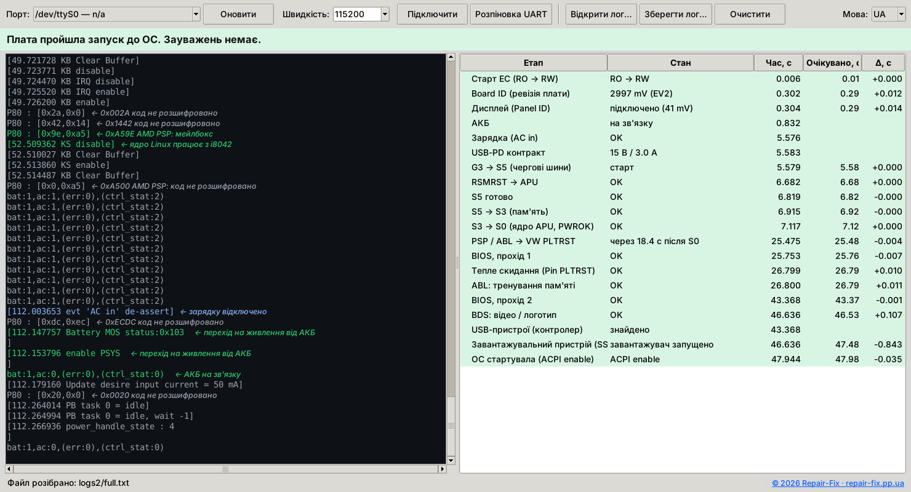
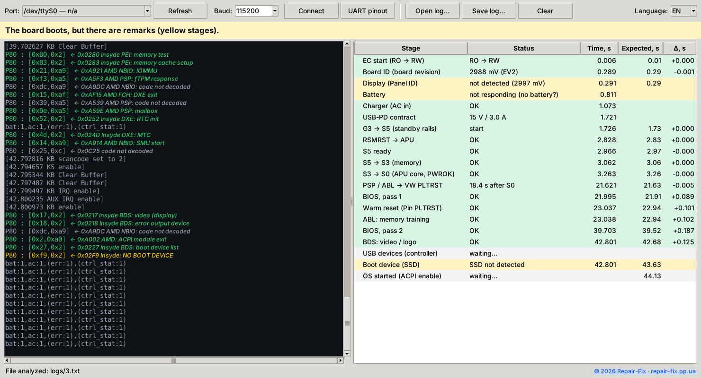
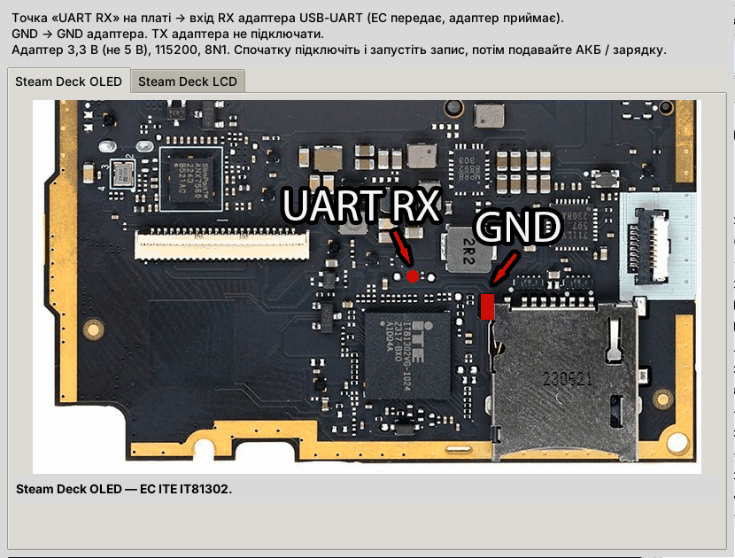

<div align="center">

# Repair-Fix UART Analyzer

**Анализатор UART-лога EC для Steam Deck OLED: power sequence, POST-коды BIOS, диагностика зависаний**

[](#скачать)
[](#запуск-из-исходников)
[](#ограничения)
[](LICENSE)

[Українська](README.md) · [English](README.en.md) · **Русский**



</div>

## Что это

Программа для ремонтника. Подключаете USB-UART к EC платы Steam Deck OLED, подаёте питание — и в реальном времени видите, на каком этапе запуска плата: секвенсор питания, PSP и тренировка памяти, BIOS, загрузка SteamOS. Каждая строка лога расшифрована, этапы раскрашены, а если плата зависла — внизу подсказка, на каком шаге и чего EC, вероятно, ждёт.

## Возможности

- Выбор COM-порта и скорости, чтение лога в реальном времени или открытие сохранённого `.txt` (можно перетащить файл на `.exe`).
- Расшифровка power sequence EC: G3 → S5 → S3 → S0, шаги `P_Seq`, RSMRST, PLTRST.
- Расшифровка POST-кодов: Insyde H2O (`0x02XX`) и AMD AGESA (`0xE0XX` ABL / память, `0xA5XX` PSP, `0xA9XX` NBIO, `0xAFXX` FCH).
- 20 этапов запуска со временем, ожидаемым временем (от G3 → S5) и отклонением Δ.
- Обнаружение зависаний: секвенсор стоит, плата застряла в S5/S3, нет PLTRST после S0, BIOS стоит на одном коде, ошибка тренировки памяти, перезагрузка EC.
- Окно «Распиновка UART» с фото точек подключения для OLED и LCD.
- Сохранение лога, языки интерфейса: українська, русский, English.

## Цвета

| Цвет | Значение |
|---|---|
| 🟢 Зелёный | Этап пройден, событие в норме |
| 🟡 Жёлтый | Что-то не подключено или не видно: АКБ, дисплей, SSD, плата контроллеров, слабый БП, отклонение тайминга |
| 🔴 Красный | Ошибка или зависание |
| ⚪ Серый | Строка без расшифровки (кода нет в известных таблицах) |



## Распиновка UART

| Точка на плате | Куда |
|---|---|
| **UART RX** | RX адаптера USB-UART (EC передаёт, адаптер принимает) |
| **GND** | GND адаптера |
| TX адаптера | не подключать |

Адаптер **3,3 В** (не 5 В), **115200, 8N1**. Сначала подключите UART и запустите запись, потом подавайте АКБ или зарядку.



## Скачать

Готовый `RepairFix_UART_Analyzer.exe` — в разделе [Releases](../../releases). Установка не нужна: скачать и запустить.

## Запуск из исходников

```bash
pip install -r requirements.txt
python deck_uart_analyzer.py                                   # с COM-портом
python deck_uart_analyzer.py samples/03_bare_board_no_ssd.txt  # сразу открыть лог
```

Нужен Python 3.8+ с tkinter (есть в стандартном установщике с python.org).

## Сборка .exe

Положите свой `icon.ico` рядом со скриптом (необязательно) и запустите:

```bat
build_exe.bat
```

Результат — `dist\RepairFix_UART_Analyzer.exe`. Скрипт сам закрывает запущенную копию, чистит прошлую сборку и сбрасывает кэш иконок Windows.

Также `.exe` собирается на GitHub Actions: при каждом push он появляется в артефактах, а при теге `v*` (например `v1.4.2`) — в новом релизе.

> Если после пересборки Проводник показывает старую иконку `.exe` — это кэш Windows. Переименуйте файл или перезапустите Проводник.

## Как пользоваться

1. Подключите адаптер по распиновке выше.
2. Выберите порт, скорость 115200, нажмите **«Подключить»**.
3. Подайте питание на плату (АКБ и/или зарядку).
4. Смотрите на этапы справа и на итог сверху. Для следующей платы — **«Очистить»**.
5. **«Сохранить лог…»** записывает сырой лог в `.txt`.

## Документация

В [`docs/power-sequence`](docs/power-sequence) — разбор запуска Steam Deck OLED:

- таблицы power sequence с точными записями лога и расшифровкой POST-кодов (`.xlsx`, UA и RU);
- временные диаграммы секвенсора и общая шкала запуска (`.png`);
- HTML-страница с диаграммами, пинами EC, этапами BIOS и замерами шин.

## Примеры логов

| Файл | Что подключено |
|---|---|
| [`01_no_battery_no_controllers.txt`](samples/01_no_battery_no_controllers.txt) | Без АКБ и платы контроллеров |
| [`02_no_display_with_ssd_cut.txt`](samples/02_no_display_with_ssd_cut.txt) | Без дисплея, с SSD (начало не записано) |
| [`03_bare_board_no_ssd.txt`](samples/03_bare_board_no_ssd.txt) | Голая плата, без SSD |
| [`04_battery_ssd_display.txt`](samples/04_battery_ssd_display.txt) | АКБ, SSD, дисплей |
| [`05_full_assembly_cut.txt`](samples/05_full_assembly_cut.txt) | Полная сборка (начало не записано) |
| [`06_full_assembly_battery_then_charger.txt`](samples/06_full_assembly_battery_then_charger.txt) | Полная сборка: UART → АКБ → зарядка → зарядку отключили |

Все логи — с рабочей платы DA0F7GMBAE0 rev E, EC G01090. `python tests/check_samples.py` прогоняет анализатор по всем.

## Ограничения

- Профиль настроен на **Steam Deck OLED** (EC ITE IT81302). На LCD (EC IT5570) лог может отличаться.
- Сигналы на шагах `P_Seq` в подсказках — **предположение** по референсу Chromebook на IT8320, помечены «предп.». Для точной привязки нужен осциллограф.
- Коды AMD взяты из таблиц AGESA серверных плат (Gigabyte MJ11-EC0, MZ01-CEx). Для APU Van Gogh отдельные номера могут отличаться.
- Коды, которых нет ни в одной таблице, показаны серым без расшифровки.

## Автор

**Repair-Fix** — ремонт игровых консолей и электроники.
Сайт: [repair-fix.pp.ua](https://repair-fix.pp.ua)

Нашли расхождение или есть лог с другой платы или консоли — открывайте [Issue](../../issues).

## Лицензия

Программа распространяется бесплатно.

- **Код** — [GNU GPL v3](LICENSE). Можно свободно использовать, в том числе в коммерческом ремонте, менять и распространять. Изменённые версии должны идти с открытым кодом под той же лицензией и с сохранением копирайта.
- **Документация, диаграммы, таблицы и примеры логов** (`docs/`, `samples/`) — [CC BY 4.0](docs/LICENSE.txt). Можно публиковать где угодно со ссылкой на [repair-fix.pp.ua](https://repair-fix.pp.ua).
- Название и логотип **Repair-Fix** в лицензию не входят: изменённые версии публикуйте под другим названием.

© 2026 Repair-Fix
